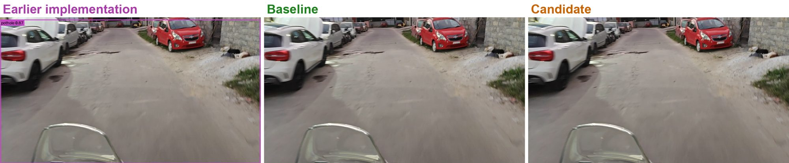
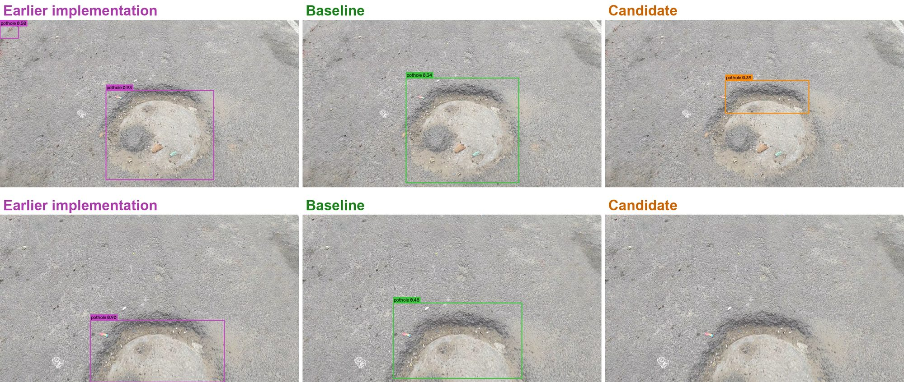
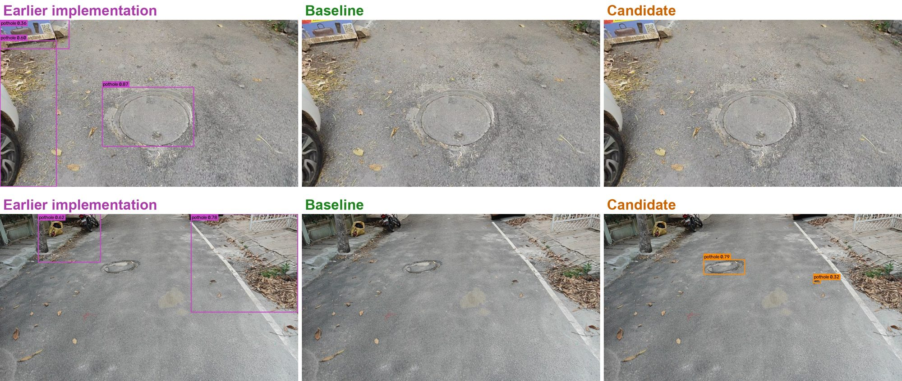

# AI Powered Pothole Detection and Intelligent Route Optimization System (V2)

V2 is a ground-up rebuild of our [first version](https://github.com/MahediBuilds/AI-Powered-Pothole-Detection-and-Intelligent-Route). It takes a forward-facing road video and its GPS log, detects potholes, places each one once on an OpenStreetMap road, keeps track of which road has actually been surveyed, and plans routes that trade distance against expected potholes.

Final-year major project, Department of Computer Science and Engineering, BMS College of Engineering, Bengaluru.

## V1 vs V2 on our own road recordings

We ran the V1 model and both V2 models over the same 13 road recordings we shot in Bengaluru on a two-wheeler (9,711 frames). Colours: **purple = V1**, **green = V2 deployed model (baseline, 640 px)**, **orange = V2 experimental model (candidate, 1280 px)**.

**An ordinary road with no pothole.** V1 draws one box around the whole frame and calls it a pothole with 0.87 confidence. Neither V2 model fires.



**A real pothole.** All three find it. V1 also adds a stray box in the corner. In the second frame the 1280 px candidate misses it, which is one reason the 640 px baseline is the deployed model.



**Manhole covers and roadside clutter.** V1 boxes the manhole cover, the car's wheel area, a signboard and the kerb. The deployed V2 model leaves the frame clean. The candidate still mistakes the second manhole for a pothole.



### Across all 13 recordings

| Model | Detections | Frames with a detection | Boxes covering 80%+ of the frame |
|---|---:|---:|---:|
| V1 (YOLOv8s-seg, 640 px) | 9,665 | 77.3% | 3,107 |
| **V2 baseline (YOLOv8s, 640 px, deployed)** | **1,913** | **15.9%** | **0** |
| V2 candidate (YOLOv8s, 1280 px, experimental) | 3,049 | 21.7% | 0 |

Most of these roads have only a few potholes, yet V1 flags more than three frames in four, and about a third of its boxes are the whole picture. Our recordings have no hand-drawn ground truth, so this table shows behaviour, not accuracy. The accuracy numbers below come from labelled test sets.

## What changed from V1

| | V1 | V2 |
|---|---|---|
| Detector | YOLOv8s-seg trained on frames from a single set of videos | YOLOv8s trained on RDD2022 (plus HRP4K for the 1280 px model), with near-duplicate images grouped so the same scene never lands in both train and test |
| Evaluation | Test split cut from the same videos as training, so the reported 0.905 mAP50 said nothing about new roads or cameras | Held-out test sets, thresholds chosen on validation data only, 95% bootstrap confidence intervals, and a separate manhole set used only for testing |
| Tracking | ByteTrack on every fifth frame | Motion-aware IoU tracker; how often frames are checked depends on GPS speed |
| Mapping | Raw GPS positions | Sightings within 8 m merged into one pothole, snapped to the nearest road within 30 m |
| Survey coverage | Not recorded, so an unrecorded road looked as clean as a recorded clean one | Surveyed length kept per road segment, and each route reports how much of it was actually surveyed |
| Routing | Public OSRM server, counting potholes within 20 m of each route | Dijkstra on a local OpenStreetMap graph (2,996 nodes, 7,138 edges); cost adds expected potholes to length; no external routing server |
| Testing | 33 unit tests | 1,101 automated tests |

## Results on labelled test data

| Test set | Metric | V2 baseline (640 px) | V2 candidate (1280 px) |
|---|---|---:|---:|
| RDD2022 test | mAP50 | 0.497 | 0.453 |
| HRP4K test (forward-view dashcam) | mAP50 | 0.018 | 0.454 |
| HRP4K test | F1 | 0.035 | 0.501 |
| Manhole probe (203 images) | mAP50 | 0.368 | 0.427 |

The candidate is far better on forward-view dashcam footage (+0.435 mAP50 on HRP4K, 95% CI 0.392 to 0.479). It is slightly worse on RDD2022, and it does not confuse manholes any less. The 640 px baseline stays the deployed model for now, at about 8.2 ms per frame on an RTX 4060 laptop GPU.

## Repository layout

```
Poster/          Project poster (PPTX, PDF, A3 print PDF and JPG)
Report/          Project report (LaTeX sources and main.pdf)
Presentation/    Presentation deck (PPTX, PDF) and speaker scripts for 2 and 3 presenters
src/roadsense/   Application package: ingest, detection, tracking, geo, routing, API, web UI
scripts/         Training, evaluation and analysis scripts
configs/         Application and experiment configuration
tests/           Automated test suite
docs/            Design notes and API reference
data/graphs/     OpenStreetMap road graph used by the route planner
runs/train/      Trained detector weights (baseline best.pt, candidate epoch25.pt)
assets/          Images used in this README
```

Not included: the training datasets (RDD2022, HRP4K) and our raw road recordings, which contain GPS tracks.

## Running the application

Requires Python 3.10+. An NVIDIA GPU is optional; without one the detector runs on the CPU.

```bash
python -m venv .venv
.venv\Scripts\python.exe -m pip install --upgrade pip
.venv\Scripts\python.exe -m pip install torch torchvision --index-url https://download.pytorch.org/whl/cu126
.venv\Scripts\python.exe -m pip install -e ".[ml,api,geo,dev]"
```

For a CPU-only machine, install `torch` and `torchvision` without `--index-url`. On Linux or macOS, use `.venv/bin/python`.

```bash
.venv\Scripts\python.exe -m pytest -q          # run the test suite
.venv\Scripts\python.exe -m roadsense.api      # start the server, then open http://127.0.0.1:8000/
```

Upload a road video with its GPS CSV (`timestamp_sec,lat,lon,accuracy_m,speed_mps,bearing_deg,altitude_m,utc_ms`) on the Upload tab. Check Sessions and Detections for the tracked potholes, the Dashboard for the map, and the Route planner to compare routes. To try the 1280 px model, set `detection.weights` to `runs/train/unified_v1_y8s_1280/weights/epoch25.pt` and `detection.imgsz` to `1280` in `configs/app.yaml`. The HTTP API is documented in `docs/api.md`.

## Team

- Zain Mahedi (1WA23CS056)
- Thanu George (1WA23CS019)
- Vikas Shashi (1WA23CS043)
- Tanish Agrawal (1WA23CS008)

Guide: Dr. Seema Patil, Associate Professor, Department of CSE, BMS College of Engineering.
